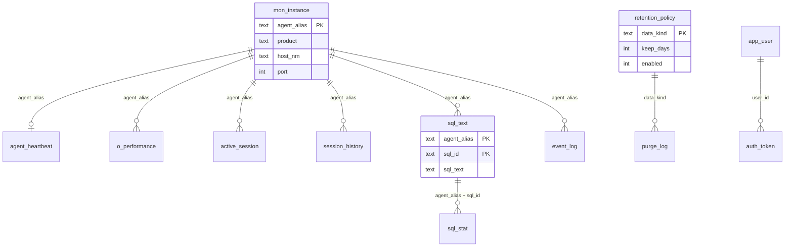

# OKEDBMON DB ERD

- 버전: 1.0.0.0
- 기준일: 2026-11-14
- 물리 저장소: `data/okedbmon.sqlite`
- 시각 형식: `YYYY-MM-DD HH:MM:SS`

## 1. 물리 ERD

테이블은 월별·일별로 나누지 않는다. 한 SQLite 파일의 고정 테이블이고, 보관 주기가 지난 행을 삭제한다.

| 테이블 | 내용 |
|---|---|
| app_user, auth_token | 로그인 |
| env_setting | 제품명, 버전, 토큰, 임계치, 보관일수 |
| retention_policy, purge_log | 종류별 보관과 삭제 이력 |
| mon_instance | 모니터링 대상 |
| agent_heartbeat | 마지막 수집 시각, 상태, 버전 |
| o_performance | 수집 1회당 성능 1행 |
| active_session | 그 수집 시각의 세션 스냅샷 |
| session_history | Active Session 이력 |
| sql_text | 인스턴스+SQL ID당 전문 1행 |
| sql_stat | 수집 구간 SQL 수행 통계 |
| event_log | 임계치 이벤트 |

조회 인덱스는 `agent_alias + agent_collect_tm`이다. `sql_text`는 `last_seen`, `event_log`는 `occurred_at`이다.

## 2. 논리 설정

| 논리 | 위치 |
|---|---|
| 사용자, 토큰 | `app_user`, `auth_token` |
| 제품 설정, 임계치, 보관 기본값 | `env_setting`. 최초 값은 `config/default.properties` |
| 인스턴스 등록 | `mon_instance` |
| 에이전트 접속 정보 | DB 서버의 `config/agent.json`. 수집 DB에 비밀번호를 두지 않음 |
| 수집 스냅샷과 이력 | 위 물리 테이블 |
| 화면 선택 | 브라우저 `localStorage` |

## 3. 삭제

보관 주기가 켜진 종류만 지운다. 기준 시각은 현재 시각에서 보관일수를 뺀 값이다.

| data_kind | 테이블 | 시각 컬럼 | 기본 일수 |
|---|---|---|---|
| performance | o_performance | agent_collect_tm | 14 |
| active_session | active_session | agent_collect_tm | 2 |
| session_history | session_history | agent_collect_tm | 7 |
| sql_stat | sql_stat | agent_collect_tm | 14 |
| sql_text | sql_text | last_seen | 30 |
| event | event_log | occurred_at | 30 |

같은 인스턴스·같은 수집 시각의 Active Session은 수신 때 그 시각 행을 지우고 다시 넣는다. SQL Text는 `agent_alias + sql_id`가 있으면 전문과 `last_seen`만 갱신한다.
